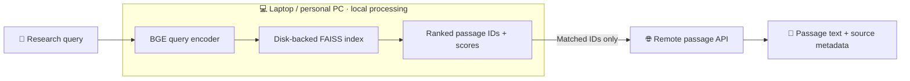

<div align="center">


# <u>LLM</u> <u>Pre</u>training <u>S</u>emantic <u>S</u>earch

<p align="center"><a href="https://colab.research.google.com/github/my-unknown-account/LLMPreSS/blob/main/notebooks/interactive_search.ipynb"></a>&nbsp;<a href="https://huggingface.co/collections/JamshidJDMY/llmpress"></a>&nbsp;<a href="#quick-start"></a>&nbsp;<a href="pyproject.toml"></a></p>

**[🚀 Quick start](#quick-start)** · **[✨ Why LLMPreSS?](#why-llmpress)** · **[🧠 How it works](#how-it-works)** · **[📚 Indexes](#indexes-and-editions)** · **[🐍 Python API](#python-api)** · **[⚙️ Configuration](#configuration)**

### Semantic exploration of LLM pretraining data, now within everyone's reach.

Searching LLM pretraining corpora semantically has traditionally demanded substantial computational resources, memory, and specialized infrastructure. **LLMPreSS changes that.**

With prebuilt, compressed FAISS indexes, LLMPreSS makes large-scale semantic retrieval practical on **your own laptop or personal computer**. No powerful GPU, high-end CPU, or dedicated search server is required. Semantic search runs **locally**, while a lightweight remote API retrieves only the matching passages and their available source metadata.

</div>

---

<a id="why-llmpress"></a>

## ✨ Why LLMPreSS?

### Semantic access to pretraining data should not require a search cluster.

Modern LLMs are trained on enormous collections of text, but investigating **what those corpora actually contain** is difficult. Searching billions of passages semantically has often meant building and maintaining large vector-search infrastructure, with costly storage, memory, and compute requirements. Exact keyword search is easier to deploy, but it can miss relevant passages that describe the same facts, ideas, or events with different words.

**LLMPreSS changes the practical starting point:** download a compressed, disk-backed semantic index and explore it directly from an ordinary laptop or personal desktop. The FAISS search runs on the CPU; there is no need to host your own vector database, load the original text corpus into RAM, or purchase specialized GPU hardware. Matching passage text is fetched remotely only when you request results.

### 🔬 What can researchers investigate?

Semantic retrieval opens up research questions that exact lexical matches alone can easily miss:

1. **🧠 Factual reliability and hallucinations** — Retrieve candidate training passages related to an LLM's answer, even when the answer paraphrases the underlying information. Examine whether supporting or conflicting information appears in the pretraining corpus.
2. **🧪 Semantic benchmark contamination** — Look for passages that express the same question, task, or solution as a benchmark example without reproducing its exact wording. Go beyond detecting copied strings.
3. **🧩 Non-verbatim memorization** — Investigate whether generated explanations, stories, or solutions resemble material in pretraining data despite rewriting, summarization, or other linguistic changes.
4. **🌍 Long-tail knowledge and coverage** — Explore how rare entities, specialized scientific topics, or less-discussed concepts are represented across varied descriptions and terminology, rather than relying on one exact name or phrase.
5. **⚖️ Bias, framing, and conflicting narratives** — Surface semantically related passages about the same subject that use different vocabulary or perspectives, helping researchers study representations, stereotypes, and competing claims.

> [!NOTE]
> **Semantic retrieval complements lexical search; it does not replace it.** Retrieved matches provide candidate evidence that information was present in a corpus—not proof that a model memorized a passage or learned a particular answer from it.

> [!TIP]
> **Your laptop is the search engine.** Local BGE query encoding and CPU-based FAISS retrieval do not require a dedicated server, GPU, or high-end CPU. The compressed index is stored on disk rather than requiring the entire pretraining corpus in memory. Once the index and encoder are downloaded, only the passage-text and metadata lookup needs an internet connection. Disk requirements vary by corpus and edition.

<a id="quick-start"></a>

## 🚀 Quick start

> **💻 Platform support:** LLMPreSS currently supports **Linux and macOS**. **Windows support is coming soon.**

### ① Install

```bash
git clone https://github.com/my-unknown-account/LLMPreSS.git
cd LLMPreSS
python -m pip install .
```

### ② Search semantically

```python
from llmpress import SemanticIndex

# Automatically loads or downloads the selected index.
index = SemanticIndex("ClimbMix", edition="compact", verbose=True)

results = index.search("Hamiltonian paths in cubic graphs", top_k=5)

for hit in results:
    print(f"#{hit.rank} | score={hit.score:.4f} | id={hit.passage_id}")
    print(hit.text)
    print()
```

**One query. Ranked semantic matches. Passage text and source details.**

On first use, LLMPreSS automatically downloads the selected published index and the BGE encoder specified by the index, then caches them for future searches.

Prefer a Python script on your computer? Run the [local example](notebooks/example_search.py):

```bash
python notebooks/example_search.py
```

### ☁️ Try LLMPreSS online with Google Colab

**Don't want to install LLMPreSS or download large indexes onto your own computer?** Run everything in **Google Colab**, directly from your browser. The index files are downloaded to the **Colab runtime**, not your laptop.

**[🚀 Open the interactive notebook in Google Colab](https://colab.research.google.com/github/my-unknown-account/LLMPreSS/blob/main/notebooks/interactive_search.ipynb)**

The notebook automatically **installs LLMPreSS**, downloads the **selected corpus index and matching BGE encoder** to the Colab environment, and lets you **enter semantic queries and explore ranked passages and source metadata**. You can also export results to JSON.

The example starts with **ClimbMix**. Choose a Colab runtime with enough available disk space and memory for your selected index; free runtime resource limits may vary.

<a id="how-it-works"></a>

## 🧠 How it works

### Your computer handles the search. The API only retrieves the text.



**① Encode locally —** Your query is converted into a semantic vector by the BGE encoder selected in the index metadata. LLMPreSS uses the encoder's **pinned model revision** to keep query encoding consistent with the published index. Encoding runs on your CPU by default, with optional GPU support.

**② Search locally —** FAISS searches the downloaded, compressed vector index **on your laptop or personal computer**. It returns ranked passage IDs and similarity scores. The large text corpus does not need to be hosted locally, and **your query is not sent to a remote semantic search service**.

**③ Retrieve matched passages remotely —** Only after the local search identifies the relevant passage IDs does LLMPreSS contact the passage API. The API resolves those IDs into **passage text and available source metadata**. It does **not** encode your query, search the vector index, or determine the semantic ranking.

**The separation matters:** you get control over local semantic retrieval without operating a server that stores or searches the full pretraining corpus. Internet access is needed for the initial downloads and for retrieving the matching text; the downloaded encoder and index support local vector search.

<a id="indexes-and-editions"></a>

## 📚 Indexes and editions

Explore the complete **[LLMPreSS index collection on Hugging Face](https://huggingface.co/collections/JamshidJDMY/llmpress)**. Each currently published corpus has both **Compact** and **Quality** editions:

| Corpus | Indexed passages | 📦 Compact | 🎯 Quality |
| :--- | ---: | ---: | ---: |
| **RedPajama** | ~1.53 billion | [**~61.5 GB**](https://huggingface.co/datasets/JamshidJDMY/LLMPreSS_RedPajama_compact) | [**~110.5 GB**](https://huggingface.co/datasets/JamshidJDMY/LLMPreSS_RedPajama_quality) |
| **ClimbMix** | ~614 million | [**~24.8 GB**](https://huggingface.co/datasets/JamshidJDMY/LLMPreSS_ClimbMix_compact) | [**~44.5 GB**](https://huggingface.co/datasets/JamshidJDMY/LLMPreSS_ClimbMix_quality) |
| **Amber** | ~1.21 billion | [**~48.5 GB**](https://huggingface.co/datasets/JamshidJDMY/LLMPreSS_Amber_compact) | [**~87.1 GB**](https://huggingface.co/datasets/JamshidJDMY/LLMPreSS_Amber_quality) |

*Sizes are approximate downloads (decimal GB) for `index.faiss` + `lists.ivfdata`, excluding the separately cached encoder and any filesystem/download overhead. Click a size to view its Hugging Face repository.*

- **📦 Compact:** Prioritizes a smaller index footprint for personal-computer use.
- **🎯 Quality:** Uses a higher-fidelity index configuration, trading additional storage for improved retrieval quality.

Both editions are designed for local FAISS search. **Choose the edition that fits your available disk space and memory**, and check the published index files before downloading. The editions differ in index storage and retrieval configuration, not in whether they require a search server.

### Automatic downloads and caching

Simply choose a corpus and edition in `SemanticIndex`. LLMPreSS finds the corresponding published index, downloads it when necessary, and reuses the local cached files on subsequent runs.

Default cache location:

```text
~/.cache/llmpress/<corpus>/<edition>/
```

To keep an index in a custom directory:

```python
from llmpress import SemanticIndex

index = SemanticIndex(
    "RedPajama",
    edition="quality",
    index_dir="/data/indexes/redpajama-quality",
    threads=32,
    verbose=False,
)
```

The index directory contains the FAISS index, its disk-backed vector data, and metadata. The encoder is cached separately at the revision specified by that metadata.

<a id="python-api"></a>

## 🐍 Python API

### Retrieve passage text

Use `search()` when you want passages and available source metadata:

```python
results = index.search("Hamiltonian paths in cubic graphs", top_k=20)

for hit in results:
    print(hit.rank, hit.score, hit.passage_id)
    print(hit.text)
    print(hit.source_rel_path)
```

The method returns a ranked list of `SearchResult` objects:

| Field | Meaning |
| :--- | :--- |
| `numeric_id` | Numeric passage identifier within the corpus. |
| `passage_id` | Original passage identifier, if available. |
| `score` | Local vector-search score; higher is better. |
| `rank` | One-based result position. |
| `text` | Passage text fetched from the API. |
| `corpus` | Corpus name. |
| `source_rel_path` | Relative source-file path, if available. |
| `source_group` | Source group, if available. |
| `source_record_index` | Source record index, if available. |

Missing optional metadata fields are `None`.

<details>
<summary><strong>📤 Export results to JSON</strong></summary>

Use `to_dict()` to include additional API metadata and omit unavailable optional fields:

```python
import json
from pathlib import Path

query = "Hamiltonian paths in cubic graphs"
results = index.search(query, top_k=20)

payload = {"query": query, "results": [hit.to_dict() for hit in results]}
Path("results.json").write_text(
    json.dumps(payload, ensure_ascii=False, indent=2),
    encoding="utf-8",
)
```

</details>

<a id="configuration"></a>

## ⚙️ Configuration

Customize how LLMPreSS loads indexes, uses CPU resources, and connects to the passage API:

```python
from llmpress import SemanticIndex

index = SemanticIndex(
    "RedPajama",
    edition="compact",
    device="cpu",
    threads=32,
    nprobe=None,
    api_url="https://api.jmozafari.com",
    verbose=True,
)
```

| Option | Purpose |
| :--- | :--- |
| `index_dir` | Directory for loading/downloading the index. |
| `device` | Encoder device: CPU by default, or e.g. `"cuda:0"`. |
| `threads` | CPU thread count for FAISS search. |
| `nprobe` | Override the index search breadth. |
| `api_url` | Passage service URL; default `https://api.jmozafari.com`. |
| `timeout` | API request timeout in seconds. |
| `verbose` | Client progress and status output. |

For detailed options, use `help(SemanticIndex)`. The lower-level `SemanticSearcher` is available for advanced integrations.

<details>
<summary><strong>🚀 GPU query encoding</strong></summary>

Install a compatible CUDA build of PyTorch and select the encoder device:

```python
index = SemanticIndex("RedPajama", edition="compact", device="cuda:0")
```

**Only the query encoder** uses the GPU. FAISS search stays on the CPU.

</details>

<details>
<summary><strong>🌐 Passage API behavior and service notices</strong></summary>

Requests exceeding **1,000 passage IDs** are divided into sequential API batches and combined in order. If a request fails, the client does not return a partial result list.

Service notices (`info`, `warning`, `critical`) appear on stderr, including with `verbose=False`. Identical notices appear once per search. Set `NO_COLOR=1` to disable terminal colors; third-party libraries use their own output settings.

</details>

## 🛠️ Development

Install an editable package:

```bash
python -m pip install -e .
```

Build the distribution:

```bash
python -m pip install build
python -m build
```

Outputs are placed under `dist/`. The wheel includes the library and package metadata but not the large index files; the interactive example is excluded from distributions.

<details>
<summary><strong>📁 Repository layout</strong></summary>

```text
.
├── assets/
│   ├── LLMPreSS-logo.svg
│   └── stickers/
│       ├── semantic-search.svg
│       ├── local-faiss.svg
│       ├── index-editions.svg
│       ├── passage-metadata.svg
│       └── python-api.svg
├── llmpress/
│   ├── __init__.py
│   ├── __main__.py
│   ├── semantic_search.py
│   ├── _index_files.py
│   └── _engine.py
├── notebooks/
│   └── interactive_search.ipynb
├── notebooks/example_search.py
├── pyproject.toml
├── requirements.txt
└── README.md
```

</details>

---

<div align="center">

### 💻 Corpus-scale semantic retrieval, accessible from your personal computer.

<a href="https://huggingface.co/collections/JamshidJDMY/llmpress"><strong>📚 Browse indexes</strong></a>
&nbsp; · &nbsp;
<a href="notebooks/interactive_search.ipynb"><strong>🚀 Try the notebook</strong></a>
&nbsp; · &nbsp;
<a href="https://github.com/my-unknown-account/LLMPreSS/issues"><strong>💬 Report an issue</strong></a>

</div>
