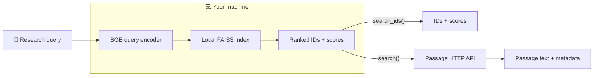

<div align="center">


# LLMPreSS

**LLM Pretraining Semantic Search**

### Search LLM pretraining corpora, semantically.

Explore pretraining data through **semantic passage retrieval**. Ask a question, search a local FAISS index, and retrieve relevant passages with available source metadata—even when the passages use different wording.

<p>
  <a href="https://colab.research.google.com/github/my-unknown-account/LLMPreSS/blob/main/notebooks/interactive_search.ipynb"></a>
  <a href="https://huggingface.co/collections/JamshidJDMY/llmpress"></a>
</p>
<p>
  <a href="#quick-start"></a>
  <a href="#how-it-works"></a>
  <a href="pyproject.toml"></a>
</p>

**[🚀 Quick start](#quick-start)** · **[✨ Features](#why-llmpress)** · **[🧠 How it works](#how-it-works)** · **[📚 Indexes](#indexes-and-editions)** · **[🐍 Python API](#python-api)** · **[⚙️ Configuration](#configuration)**

</div>

---

## ✨ Why LLMPreSS?

LLMPreSS makes large LLM pretraining corpora accessible through **semantic retrieval**, rather than requiring exact keyword or phrase matches. Query vectors and FAISS search run locally; passage text and metadata are fetched from a separate API when requested.

<table>
  <tr>
    <td align="center" width="50%" valign="top">
      <br />
      <strong>🔎 Semantic passage search</strong><br />
      Find passages that are semantically relevant, including those expressed with different terminology.
    </td>
    <td align="center" width="50%" valign="top">
      <br />
      <strong>💻 Local FAISS retrieval</strong><br />
      Run vector search on your computer, without a hosted vector-search service.
    </td>
  </tr>
  <tr>
    <td align="center" valign="top">
      <br />
      <strong>📦 Downloadable index editions</strong><br />
      Select a published corpus and choose between <code>compact</code> and <code>quality</code>.
    </td>
    <td align="center" valign="top">
      <br />
      <strong>📄 Passage text &amp; metadata</strong><br />
      Retrieve ranked matches with passage text and available source information.
    </td>
  </tr>
  <tr>
    <td align="center" valign="top">
      <br />
      <strong>🐍 Python-first workflow</strong><br />
      Load once, run repeated queries, and export structured results as JSON.
    </td>
    <td align="center" valign="top">
      <br />
      <strong>⚡ API-free ID retrieval</strong><br />
      Search for passage IDs and scores locally with <code>search_ids()</code>.
    </td>
  </tr>
</table>

> [!IMPORTANT]
> **Local search ≠ local passage text.** Both search methods run FAISS locally. `search()` contacts the passage API for text and metadata, whereas `search_ids()` returns local IDs and scores without calling the API.

## 🚀 Quick start

**Requirements:** Python 3.10+ and enough RAM and disk space for the selected index.

### ① Install

```bash
git clone https://github.com/my-unknown-account/LLMPreSS.git
cd LLMPreSS
python -m pip install .
```

### ② Search semantically

```python
from llmpress import SemanticIndex

# Automatically loads or downloads the selected index.
index = SemanticIndex("ClimbMix", edition="compact", verbose=True)

results = index.search("Hamiltonian paths in cubic graphs", top_k=5)

for hit in results:
    print(f"#{hit.rank} | score={hit.score:.4f} | id={hit.passage_id}")
    print(hit.text)
    print()
```

**One query → ranked semantic matches → passage text and metadata.**

> [!NOTE]
> On first use, LLMPreSS downloads the selected **published** index and the index-specified BGE encoder if they are not already cached. The Python package does not include the index or encoder files. Automatic index downloads work only for editions available on Hugging Face.

### ③ Try the notebook

Prefer an interactive interface? **[Open the Google Colab notebook](https://colab.research.google.com/github/my-unknown-account/LLMPreSS/blob/main/notebooks/interactive_search.ipynb)** to search ClimbMix using a query box, inspect ranked passages and source metadata, and optionally export JSON.

Or run the [local example](example_search.py):

```bash
python example_search.py
```

## 🧠 How it works



**Encode → Retrieve → Resolve.** The index defines the query encoder and its pinned model revision. The encoder transforms your query into a vector; FAISS searches the local index; `search()` then requests matched passages from the HTTP API.

| Step | Runs where | What happens |
| :--- | :--- | :--- |
| **🧠 Encode** | Local CPU by default; optional CUDA | Convert the query to a vector using the index-specified BGE encoder. |
| **🔍 Retrieve** | Local CPU | Search the FAISS index for ranked passage IDs and scores. |
| **📄 Resolve** | Remote passage API, for `search()` only | Fetch text and available source metadata for the matches. |

## 📚 Indexes and editions

Browse the **[LLMPreSS index collection on Hugging Face](https://huggingface.co/collections/JamshidJDMY/llmpress)** for published corpora and editions. A corpus may have two downloadable editions:

| Edition | Focus |
| :--- | :--- |
| **📦 `compact`** | Smaller local index footprint. |
| **🎯 `quality`** | Index configuration oriented toward higher retrieval quality. |

Actual availability and storage requirements depend on each published corpus.

### Automatic downloads and caching

The default local cache is:

```text
~/.cache/llmpress/<corpus>/<edition>/
```

Set `index_dir` to load and download an index in a custom location:

```python
from llmpress import SemanticIndex

index = SemanticIndex(
    "RedPajama",
    edition="quality",
    index_dir="/data/indexes/redpajama-quality",
    threads=32,
    verbose=False,
)
```

| Directory state | Client behavior |
| :--- | :--- |
| **Valid index** | Loads directly; no new index download. |
| **Missing or empty** | Downloads `index.faiss`, `index.json`, and `lists.ivfdata`, then validates them. |
| **Nonempty but incompatible** | Raises `ValueError` instead of replacing the directory contents. |

Each directory stores one corpus/edition pair. Validation checks required files, metadata, declared file sizes, corpus, and edition. The encoder is cached separately by Hugging Face at the pinned revision defined by the index.

## 🐍 Python API

### Retrieve passage text

Use `search()` when you want passages and available source metadata:

```python
results = index.search("Hamiltonian paths in cubic graphs", top_k=20)

for hit in results:
    print(hit.rank, hit.score, hit.passage_id)
    print(hit.text)
    print(hit.source_rel_path)
```

The method returns a ranked list of `SearchResult` objects:

| Field | Meaning |
| :--- | :--- |
| `numeric_id` | Numeric passage identifier within the corpus. |
| `passage_id` | Original passage identifier, if available. |
| `score` | Local vector-search score; higher is better. |
| `rank` | One-based result position. |
| `text` | Passage text fetched from the API. |
| `corpus` | Corpus name. |
| `source_rel_path` | Relative source-file path, if available. |
| `source_group` | Source group, if available. |
| `source_record_index` | Source record index, if available. |

Missing optional metadata fields are `None`.

<details>
<summary><strong>📤 Export results to JSON</strong></summary>

Use `to_dict()` to include additional API metadata and omit unavailable optional fields:

```python
import json
from pathlib import Path

query = "Hamiltonian paths in cubic graphs"
results = index.search(query, top_k=20)

payload = {"query": query, "results": [hit.to_dict() for hit in results]}
Path("results.json").write_text(
    json.dumps(payload, ensure_ascii=False, indent=2),
    encoding="utf-8",
)
```

</details>

### Search locally without requesting passage text

Use `search_ids()` to return passage IDs and scores without contacting the API:

```python
matches = index.search_ids("Hamiltonian paths in cubic graphs", top_k=20)

for hit in matches:
    print(hit.numeric_id, hit.score)
```

These are also `SearchResult` objects, but `text` and `passage_id` are set to `None`. Fully offline ID retrieval requires the index and encoder to be cached locally. Both search methods accept `candidates` and `refine` options to control candidate retrieval and re-ranking.

## ⌨️ Command-line interface

Search a local index from your terminal:

```bash
llmpress \
  --index /path/to/index \
  --query "What is semantic search?" \
  --top-k 10 \
  --json
```

The CLI displays local IDs and scores. The installed `llmpress` command is equivalent to `python -m llmpress`; if `--index` is omitted, it uses the current working directory.

```bash
python -m llmpress --help
```

## ⚙️ Configuration

| Option | Purpose |
| :--- | :--- |
| `index_dir` | Directory for loading/downloading the index. |
| `device` | Encoder device: CPU by default, or e.g. `"cuda:0"`. |
| `threads` | CPU thread count for FAISS search. |
| `nprobe` | Override the index search breadth. |
| `api_url` | Passage service URL; default `https://api.jmozafari.com`. |
| `timeout` | API request timeout in seconds. |
| `verbose` | Client progress and status output. |

```python
index = SemanticIndex(
    "RedPajama",
    edition="compact",
    device="cpu",
    threads=32,
    nprobe=None,
    api_url="https://api.jmozafari.com",
    verbose=True,
)
```

For detailed options, use `help(SemanticIndex)`. The lower-level `SemanticSearcher` is available for advanced integrations.

<details>
<summary><strong>🚀 GPU query encoding</strong></summary>

Install a compatible CUDA build of PyTorch and select the encoder device:

```python
index = SemanticIndex("RedPajama", edition="compact", device="cuda:0")
```

**Only the query encoder** uses the GPU. FAISS search stays on the CPU.

</details>

<details>
<summary><strong>🌐 Passage API behavior and service notices</strong></summary>

Requests exceeding **1,000 passage IDs** are divided into sequential API batches and combined in order. If a request fails, the client does not return a partial result list.

Service notices (`info`, `warning`, `critical`) appear on stderr, including with `verbose=False`. Identical notices appear once per search. Set `NO_COLOR=1` to disable terminal colors; third-party libraries use their own output settings.

</details>

## 🛠️ Development

Install an editable package:

```bash
python -m pip install -e .
```

Build the distribution:

```bash
python -m pip install build
python -m build
```

Outputs are placed under `dist/`. The wheel includes the library and package metadata but not the large index files; the interactive example is excluded from distributions.

<details>
<summary><strong>📁 Repository layout</strong></summary>

```text
.
├── assets/
│   ├── LLMPreSS-logo.svg
│   └── stickers/
│       ├── semantic-search.svg
│       ├── local-faiss.svg
│       ├── index-editions.svg
│       ├── passage-metadata.svg
│       ├── python-api.svg
│       └── offline-results.svg
├── llmpress/
│   ├── __init__.py
│   ├── __main__.py
│   ├── semantic_search.py
│   ├── _index_files.py
│   └── _engine.py
├── notebooks/
│   └── interactive_search.ipynb
├── example_search.py
├── pyproject.toml
├── requirements.txt
└── README.md
```

</details>

---

<div align="center">

### 🔎 Discover semantically relevant evidence from LLM pretraining data.

<a href="https://huggingface.co/collections/JamshidJDMY/llmpress"><strong>📚 Browse indexes</strong></a>
&nbsp; · &nbsp;
<a href="notebooks/interactive_search.ipynb"><strong>🚀 Try the notebook</strong></a>
&nbsp; · &nbsp;
<a href="https://github.com/my-unknown-account/LLMPreSS/issues"><strong>💬 Report an issue</strong></a>

</div>
