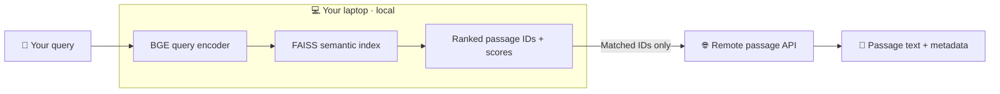

<div align="center">


# LLM Pretraining Semantic Search

### Explore LLM pretraining corpora, semantically.

**Semantic passage retrieval, right from your laptop.** Encode queries and search massive pretraining indexes locally with FAISS—no hosted vector-search engine or dedicated server required. When you want to read a match, LLMPreSS fetches **only the matching passage text and available source metadata** from a remote passage API.

Discover semantically relevant passages even when their wording differs from your query.

<p align="center">
  <a href="https://colab.research.google.com/github/my-unknown-account/LLMPreSS/blob/main/notebooks/interactive_search.ipynb"></a>
  <a href="https://huggingface.co/collections/JamshidJDMY/llmpress"></a>
  <a href="#quick-start"></a>
  <a href="pyproject.toml"></a>
</p>

**[🚀 Quick start](#quick-start)** · **[✨ Features](#why-llmpress)** · **[🧠 How it works](#how-it-works)** · **[📚 Indexes](#indexes-and-editions)** · **[🐍 Python API](#python-api)** · **[⚙️ Configuration](#configuration)**

</div>

---

## ✨ Why LLMPreSS?

**Your laptop does the semantic search. The remote API only supplies the passages.** LLMPreSS combines local query encoding and FAISS retrieval with on-demand access to pretraining passage text and source information.

<p align="center">
  
  
  
  
  
</p>

- **🔎 Semantic passage retrieval** — Find relevant passages even when they express the same topic using different terminology.
- **💻 Laptop-first, local search** — Encode your query and search the FAISS index on your own machine; CPU execution is supported, with optional GPU query encoding.
- **📦 Downloadable indexes** — Select a published corpus and choose its `compact` or `quality` edition.
- **🌐 On-demand passage retrieval** — Use the remote passage API *only* to obtain matching text and available source metadata after local retrieval.
- **🐍 Python-native workflow** — Load an index once, search repeatedly, and export structured results as JSON.

> [!IMPORTANT]
> **No hosted vector-search engine is required.** Semantic search runs locally on your laptop. For `search()`, an internet connection is needed to retrieve the matched passages and metadata from the remote API.

## 🚀 Quick start

**Requirements:** Python 3.10+ and a **laptop or desktop** with enough RAM and disk space for the selected index. **No dedicated search server or GPU is required.** Once the index and encoder are downloaded, semantic retrieval runs locally; internet access is needed to fetch passage text and metadata from the remote API.

### ① Install

```bash
git clone https://github.com/my-unknown-account/LLMPreSS.git
cd LLMPreSS
python -m pip install .
```

### ② Search semantically

```python
from llmpress import SemanticIndex

# Automatically loads or downloads the selected index.
index = SemanticIndex("ClimbMix", edition="compact", verbose=True)

results = index.search("Hamiltonian paths in cubic graphs", top_k=5)

for hit in results:
    print(f"#{hit.rank} | score={hit.score:.4f} | id={hit.passage_id}")
    print(hit.text)
    print()
```

**One query → ranked semantic matches → passage text and metadata.**

> [!NOTE]
> On first use, LLMPreSS downloads the selected **published** index and the index-specified BGE encoder if they are not already cached. The Python package does not include the index or encoder files. Automatic index downloads work only for editions available on Hugging Face.

### ③ Try the notebook

Prefer an interactive interface? **[Open the Google Colab notebook](https://colab.research.google.com/github/my-unknown-account/LLMPreSS/blob/main/notebooks/interactive_search.ipynb)** to search ClimbMix using a query box, inspect ranked passages and source metadata, and optionally export JSON.

Or run the [local example](example_search.py):

```bash
python example_search.py
```

## 🧠 How it works



**Encode locally → Search locally → Fetch matching passages remotely.** The index specifies the BGE encoder and its pinned revision. Query encoding and FAISS vector retrieval run on your laptop; the passage API does **not** perform semantic search—it resolves the matched IDs into text and available metadata.

| Step | Runs where | What happens |
| :--- | :--- | :--- |
| **🧠 Encode** | Your laptop (CPU by default; optional CUDA) | Convert the query to a vector using the index-specified BGE encoder. |
| **🔍 Retrieve** | Your laptop (CPU) | Search the local FAISS index for ranked passage IDs and scores. |
| **📄 Resolve** | Remote passage API | Retrieve passage text and available source metadata for matched IDs. |

## 📚 Indexes and editions

Browse the **[LLMPreSS index collection on Hugging Face](https://huggingface.co/collections/JamshidJDMY/llmpress)** for published corpora and editions. A corpus may have two downloadable editions:

| Edition | Focus |
| :--- | :--- |
| **📦 `compact`** | Smaller local index footprint. |
| **🎯 `quality`** | Index configuration oriented toward higher retrieval quality. |

Actual availability and storage requirements depend on each published corpus.

### Automatic downloads and caching

The default local cache is:

```text
~/.cache/llmpress/<corpus>/<edition>/
```

Set `index_dir` to load and download an index in a custom location:

```python
from llmpress import SemanticIndex

index = SemanticIndex(
    "RedPajama",
    edition="quality",
    index_dir="/data/indexes/redpajama-quality",
    threads=32,
    verbose=False,
)
```

The client handles these cases automatically:

- **Already downloaded:** A valid local index loads directly without contacting Hugging Face for the index files.
- **Not downloaded yet:** A missing or empty index directory triggers a download of `index.faiss`, `index.json`, and `lists.ivfdata`, followed by validation.
- **Incompatible files:** A nonempty directory containing an invalid index raises `ValueError`; existing files are not replaced.

Each directory contains a single corpus/edition pair. The client verifies required files, index metadata, declared file sizes, corpus, and edition. Hugging Face caches the encoder separately at the pinned revision specified by the index.

## 🐍 Python API

### Retrieve passage text

Use `search()` when you want passages and available source metadata:

```python
results = index.search("Hamiltonian paths in cubic graphs", top_k=20)

for hit in results:
    print(hit.rank, hit.score, hit.passage_id)
    print(hit.text)
    print(hit.source_rel_path)
```

The method returns a ranked list of `SearchResult` objects:

| Field | Meaning |
| :--- | :--- |
| `numeric_id` | Numeric passage identifier within the corpus. |
| `passage_id` | Original passage identifier, if available. |
| `score` | Local vector-search score; higher is better. |
| `rank` | One-based result position. |
| `text` | Passage text fetched from the API. |
| `corpus` | Corpus name. |
| `source_rel_path` | Relative source-file path, if available. |
| `source_group` | Source group, if available. |
| `source_record_index` | Source record index, if available. |

Missing optional metadata fields are `None`.

<details>
<summary><strong>📤 Export results to JSON</strong></summary>

Use `to_dict()` to include additional API metadata and omit unavailable optional fields:

```python
import json
from pathlib import Path

query = "Hamiltonian paths in cubic graphs"
results = index.search(query, top_k=20)

payload = {"query": query, "results": [hit.to_dict() for hit in results]}
Path("results.json").write_text(
    json.dumps(payload, ensure_ascii=False, indent=2),
    encoding="utf-8",
)
```

</details>

## ⚙️ Configuration

| Option | Purpose |
| :--- | :--- |
| `index_dir` | Directory for loading/downloading the index. |
| `device` | Encoder device: CPU by default, or e.g. `"cuda:0"`. |
| `threads` | CPU thread count for FAISS search. |
| `nprobe` | Override the index search breadth. |
| `api_url` | Passage service URL; default `https://api.jmozafari.com`. |
| `timeout` | API request timeout in seconds. |
| `verbose` | Client progress and status output. |

```python
index = SemanticIndex(
    "RedPajama",
    edition="compact",
    device="cpu",
    threads=32,
    nprobe=None,
    api_url="https://api.jmozafari.com",
    verbose=True,
)
```

For detailed options, use `help(SemanticIndex)`. The lower-level `SemanticSearcher` is available for advanced integrations.

<details>
<summary><strong>🚀 GPU query encoding</strong></summary>

Install a compatible CUDA build of PyTorch and select the encoder device:

```python
index = SemanticIndex("RedPajama", edition="compact", device="cuda:0")
```

**Only the query encoder** uses the GPU. FAISS search stays on the CPU.

</details>

<details>
<summary><strong>🌐 Passage API behavior and service notices</strong></summary>

Requests exceeding **1,000 passage IDs** are divided into sequential API batches and combined in order. If a request fails, the client does not return a partial result list.

Service notices (`info`, `warning`, `critical`) appear on stderr, including with `verbose=False`. Identical notices appear once per search. Set `NO_COLOR=1` to disable terminal colors; third-party libraries use their own output settings.

</details>

## 🛠️ Development

Install an editable package:

```bash
python -m pip install -e .
```

Build the distribution:

```bash
python -m pip install build
python -m build
```

Outputs are placed under `dist/`. The wheel includes the library and package metadata but not the large index files; the interactive example is excluded from distributions.

<details>
<summary><strong>📁 Repository layout</strong></summary>

```text
.
├── assets/
│   ├── LLMPreSS-logo.svg
│   └── stickers/
│       ├── semantic-search.svg
│       ├── local-faiss.svg
│       ├── index-editions.svg
│       ├── passage-metadata.svg
│       └── python-api.svg
├── llmpress/
│   ├── __init__.py
│   ├── __main__.py
│   ├── semantic_search.py
│   ├── _index_files.py
│   └── _engine.py
├── notebooks/
│   └── interactive_search.ipynb
├── example_search.py
├── pyproject.toml
├── requirements.txt
└── README.md
```

</details>

---

<div align="center">

### 💻 Search pretraining corpora locally. Explore matching passages remotely.

<a href="https://huggingface.co/collections/JamshidJDMY/llmpress"><strong>📚 Browse indexes</strong></a>
&nbsp; · &nbsp;
<a href="notebooks/interactive_search.ipynb"><strong>🚀 Try the notebook</strong></a>
&nbsp; · &nbsp;
<a href="https://github.com/my-unknown-account/LLMPreSS/issues"><strong>💬 Report an issue</strong></a>

</div>
